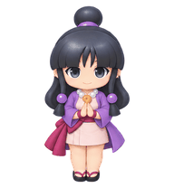

# Maya Fey / 绫里真宵 — Codex Pet

A Maya Fey companion for Codex. **Let Maya Fey, spirit medium extraordinaire, lend you a hand!**



## Install

1. Download this repository using **Code → Download ZIP**, then extract it (or clone the repository).
2. Copy the `maya-fey--kbz1121` folder into your Codex pets directory:
   - macOS / Linux: `~/.codex/pets/`
   - Windows: `%USERPROFILE%\.codex\pets\`
3. Restart Codex and select **Maya Fey / 绫里真宵** from the pet picker.

The installed folder should contain `pet.json` and `spritesheet.webp` directly. For example:

```text
~/.codex/pets/maya-fey--kbz1121/
├── pet.json
└── spritesheet.webp
```

## Package

- Codex Pet sprite format v2
- 8 × 11 spritesheet, 1536 × 2288 pixels
- Includes the standard animation states and 16 look directions
- `submission.json` contains catalog and attribution metadata; it is not needed for local installation.

## Artwork and rights

This is an unofficial, AI-generated fan-art pet inspired by Maya Fey and the *Ace Attorney* series. Maya Fey, *Ace Attorney*, and related names and characters belong to Capcom and their respective rights holders. This project is not affiliated with or endorsed by Capcom. The artwork is offered for non-commercial use only; obtain permission from the rights holders before any commercial use.

See [the Chinese README](README.zh-CN.md) for Chinese instructions.
